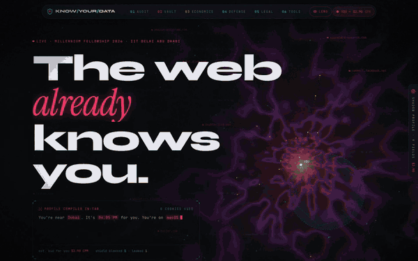
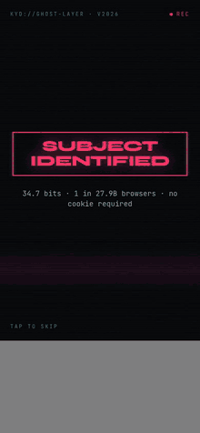

# Know Your Data

**Live:** https://knowyourdata26.vercel.app

| Desktop | Phone |
|---|---|
|  |  |
| [Full desktop tour (MP4, 90 s)](docs/demo/desktop-tour.mp4) | [Full phone tour (MP4, 80 s)](docs/demo/phone-tour.mp4) |

An interactive privacy-intelligence platform from the **Millennium Fellowship 2026** cohort at **IIT Delhi Abu Dhabi**.
Built by Lakshan Muruganandam, Aditya Rajan Sharma and Krishna. Research by Anesh, Divisha, Divya Nukala and Krishna Gaur (case studies), Saatvik, Divyam and Gauri (economics), and Lakshan, Farha and Sumayya (strategies).

## The Ghost Layer UI

Every page has two layers: the one you read, and the one that reads you.

- **Ghost Lens.** Your cursor is a lens onto the surveillance layer. Inside it the page turns into a crimson X-ray, with live session-replay telemetry: position, velocity, dwell time, scroll depth. Any element tagged `data-ghost` also shows the inference an ad-tech system would log about it. Press **G** to toggle.
- **On phones** there is no cursor, so each cursor feature has a touch equivalent:
  - **Ghost Lens:** a scope you open with the eye in the nav bar and drag with a finger. The page scrolls beneath it, and its inferences appear in a strip along the bottom of the screen.
  - **Hero shield:** it lands wherever you tap.
- **Shadow Profile dock.** A dossier built in the tab from your real browser (timezone, GPU, canvas hash, screen, languages, GPC…). It shows a live illustrative CPM "auction price" and an identifiability estimate in bits. Completing the steps in the Defense toolkit redacts fields, and the price drops.
- **Proof, not promises.** The home page reads the Performance API live to show 0 cookies and 0 third-party requests.

## Cinematic layer

- **Cold open:** the first visit in each session plays a terminal that reads your fingerprint, then "SUBJECT IDENTIFIED", then the screen tears away in shutters. You can skip it.
- **Hero:** a raw-WebGL "data ocean" shader. Crimson currents converge on you, the cursor shield glows cyan, and the camera dollies as you scroll.
- **"The 200 milliseconds after you click":** a 900vh scroll-scrubbed film in six chapters (click → pixel → auction → broker → breach → shield), built from your own browser data.
- **Route cuts:** redaction-bar wipes with a chapter card. Headlines decrypt out of glyph noise, buttons are magnetic, and cards tilt in 3D under a spotlight.
- **Per-module motion:** CRT console, 3D folder cabinet, printer-fed legal letters, odometers, armour shards, glitch strikes.
- **Reduced motion:** everything respects `prefers-reduced-motion`, falling back to still frames or a storyboard.

## Modules

| Route | Module |
|---|---|
| `/audit` | Live browser audit: WebRTC IP leak, canvas farbling, GPC/DNT, storage partitioning (heuristic), timezone leak, HTTPS/HSTS, entropy |
| `/vault` | Corporate Exploit Vault: 10 declassified case files with exploit-chain diagrams |
| `/economics` | Expected-cost simulator, Meta fines vs revenue waffle, slowed-down RTB auction |
| `/defense` | 90-minute, 7-step toolkit with a countdown and 4-layer armour configs (user.js, uBlock, DoH/ECH, WireGuard, OS telemetry, 2FA ladder) |
| `/legal` | UAE PDPL / GDPR request generator (access, objection, erasure), article explorer and a jurisdiction picker |
| `/tools` | Big-tech swap matrix, a searchable directory of 36 tools and a stack builder |

## Privacy guarantees

- Everything runs client-side. There are no API routes, no analytics and no cookies.
- Fonts are self-hosted via `next/font`, downloaded at build time.
- A nonce-based CSP with `'strict-dynamic'` is set in `middleware.ts`, so injected scripts, inline handlers and `javascript:` URLs never run. `next.config.ts` adds HSTS, COOP/CORP, `no-referrer` and a locked-down Permissions-Policy. See [SECURITY.md](SECURITY.md).
- `localStorage` is used only for the visitor's own toolkit progress, redactions and previous canvas hash.

## Stack

Next.js 15 (App Router) · TypeScript · Tailwind CSS v4 · framer-motion · Lenis · lucide-react. Charts are hand-built SVG.

```bash
npm install
npm run dev     # http://localhost:3000
npm run build && npm start
```

## Tests

End-to-end suites drive the real app in Chromium, on desktop (1440×900) and on an emulated iPhone 14 with touch input. Start the app first (`npm run build && npm start`); the suites need Playwright's Chromium (`npx playwright install chromium`) or `CHROME_PATH`.

```bash
npm run test:functions   # every module's functions, desktop + phone
npm run test:scroll      # every route, top-to-bottom wheel scroll at 375/768/1440/2000px
```

- **`test:functions` (30 checks on desktop, 36 on phone):**
  - **Audit:** the scan finishes and every check reaches a verdict.
  - **Vault:** the filters, sort and dossier open/close work.
  - **Economics:** the presets, slider, toggles and the auction run work.
  - **Defense:** ticking tasks lowers the price, progress persists across a reload, and reset works.
  - **Legal:** your details fill the letter, the GDPR/PDPL switch works, and copy and `.txt` download work.
  - **Tools:** the search, categories, add-to-stack and swap matrix work.
  - **Shadow dock:** redaction works.
  - **Phone only:** the menu works, and the lens opens and can be dragged by touch.
- **`test:scroll` checks that:**
  - text in view becomes visible while scrolling
  - there is no horizontal overflow
  - fixed elements really are fixed
  - the footer wordmark fits
  - the page reaches the bottom with no dead space
  - there are no console errors

## Deploy

```bash
gh repo create lakshanmuruganandam/know-your-data-site --public --source=. --push
npx vercel@latest           # link + preview
npx vercel@latest --prod    # production → knowyourdata26.vercel.app
```

No environment variables are needed. The Vercel project is connected to this repo, so every push to `main` deploys to production.

*Educational project. Not legal advice.*
